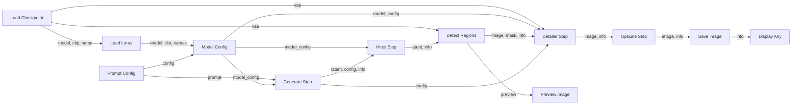
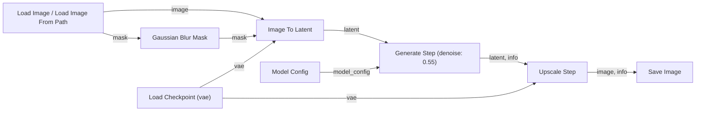
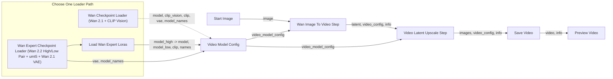
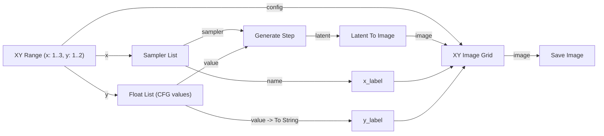

# NE.ComfyUI.Tools (`comfyui-ne-tools`)

A ComfyUI custom-node extension providing **89 nodes** under `NE.Tools` and **18 frontend extensions** for local image and video generation pipelines.

Instead of wiring loose parameters across a graph, `comfyui-ne-tools` passes **validated typed bundles** (`MODEL_CONFIG`, `VIDEO_MODEL_CONFIG`, `SAMPLER_CONFIG`, `VIDEO_CONFIG`, `PIPELINE_INFO`) through self-contained **Step nodes** — each with an `active` bypass toggle and automatic parameter logging.

---

## Core Concepts

### 1. Typed Bundles on the Wire

| Wire Type | Produced By | Carries | Consumed By |
| --- | --- | --- | --- |
| `PROMPT_CONFIG` | `Prompt Config` | Cleaned prompt parts (`positive`, `posture`, `background`, `negative`, `positive_style`, `negative_style`), separator, style placement, tag-weight flag | `Model Config` |
| `MODEL_CONFIG` | `Model Config` | `MODEL`, `CLIP`, encoded positive/negative conditioning, raw `PromptConfig` copy, `model_name`, `loras_name` | `Generate Step`, `Hires Step`, `Detailer Step` |
| `VIDEO_MODEL_CONFIG` | `Video Model Config` | High-noise `MODEL`, optional low-noise `MODEL`, `CLIP`, `VAE`, optional `CLIP_VISION`, encoded prompts, sigma `boundary`, model/LoRA names | `Wan Image To Video Step`, `Wan VACE To Video Step`, `Video Latent Upscale Step`, `Video Decode` |
| `SAMPLER_CONFIG` | `Generate Step` | Resolved `seed`, `sampler`, `scheduler`, `steps`, `cfg`, `denoise` | `Hires Step`, `Detailer Step` |
| `VIDEO_CONFIG` | `Wan * Step` | `width`, `height`, `frames`, `fps`, `shift` | `Video Upscale Step`, `Video Latent Upscale Step`, `Save Video` |
| `PIPELINE_INFO` | Every Step & `Detect Regions` | Accumulated human-readable run log (`text`) + output stem (`name`, seeded upstream) | Next Step in chain, `Save Image`, `Save Video`, `Preview Image`, `Preview Video`, `Display Any` |
| `XY_RANGE_CONFIG` / `XYZ_RANGE_CONFIG` | `XY Range` / `XYZ Range` | Current `(x, y[, z])` coordinates and bounds across queued runs | `XY Image Grid` / `XYZ Image Grid` |

### 2. Single-Path Step Pipeline

Every processing stage is a single Step node (`Generate Step`, `Hires Step`, `Detailer Step`, `Upscale Step`, `Video Latent Upscale Step`, `Video Upscale Step`). Turning `active` to `false` on any step passes the payload through untouched and logs `Active: False` in `PIPELINE_INFO` without rewiring links.

---

## Installation

Clone into ComfyUI's `custom_nodes` folder:

```bash
cd ComfyUI/custom_nodes
git clone https://github.com/AkiEvansDev/NE.ComfyUI.Tools.git comfyui-ne-tools
```

Install Python dependencies into the ComfyUI virtual environment:

```bash
# Windows (portable / venv)
../../venv/Scripts/python.exe -m pip install -r requirements.txt

# Linux / macOS
pip install -r requirements.txt
```

> **Note on `onnxruntime`:** `requirements.txt` installs `onnxruntime-gpu` on Windows and Linux so `Detect Regions` and MobileSAM run on `CUDAExecutionProvider` (~4 ms per YOLO forward vs ~150 ms on CPU), and falls back to `onnxruntime` on macOS. Do not install both `onnxruntime` and `onnxruntime-gpu` in the same environment — they share the `onnxruntime` module namespace and shadow each other; the startup check accepts any installed `onnxruntime*` variant.

> **Note on startup requirement check:** By default (`NE_TOOLS_AUTO_INSTALL=warn`), `__init__.py` prints a warning at startup if packages from `requirements.txt` are missing without modifying your environment. Set `NE_TOOLS_AUTO_INSTALL=1` to install missing packages automatically via `pip`, or `NE_TOOLS_AUTO_INSTALL=0` to disable the check completely.

---

## Optional Local Model Weights

Model weights for detection, segmentation, background removal, and learned latent upscaling live under `comfyui-ne-tools/model/` (git-ignored). Create only the subfolders you need:

```text
comfyui-ne-tools/
└── model/
    ├── detect/
    │   ├── hand_yolov8s.onnx                   # YOLOv8 detection or -seg models (.onnx, 640x640)
    │   └── person_yolov8s-seg.onnx
    ├── segment/
    │   ├── mobile_sam_image_encoder.onnx       # MobileSAM encoder (Acly/MobileSAM)
    │   └── sam_mask_decoder_single.onnx        # MobileSAM single-mask decoder (Acly/MobileSAM)
    ├── rembg/
    │   └── birefnet.safetensors                # BiRefNet weights (1024x1024)
    └── sdxl_resizer.pt                         # Learned latent upscaler weights
```

| Feature / Node | Path under `comfyui-ne-tools/` | Notes & Upstream Source |
| --- | --- | --- |
| `Detect Regions` | `model/detect/*.onnx` | Any 640×640 YOLOv8 detection or `-seg` ONNX model (e.g., exported from `Bingsu/adetailer` `.pt` weights). Listed dynamically in the `model` combo. |
| `Detect Regions` (`shape = segment`) | `model/segment/mobile_sam_image_encoder.onnx`<br>`model/segment/sam_mask_decoder_single.onnx` | Refines bounding boxes from box-only detectors (like `hand_yolov8s.onnx`) into tight pixel outlines via [Acly/MobileSAM](https://huggingface.co/Acly/MobileSAM). Segmentation YOLO exports (`*-seg.onnx`) use their own masks directly. |
| `BRIA Rem BG` / `BRIA Rem BG Advanced` | `model/rembg/birefnet.safetensors` | BiRefNet architecture (`swin_v1_l`, 1024×1024), managed via ComfyUI's `ModelPatcher` so VRAM is evicted automatically when idle. |
| `Upscale Latent By Model` / `Hires Step` (`custom (sdxl_resizer)`) | `model/sdxl_resizer.pt` | Learned 4-channel SDXL latent resizer. Standard latent modes (`bislerp`, `bicubic`, etc.) require no extra file. |

<details>
<summary>Exporting a YOLOv8 <code>.pt</code> detector to <code>.onnx</code> without polluting the ComfyUI venv</summary>

`ultralytics` pulls in `matplotlib`, `pandas`, and `seaborn`. Export in a temporary venv that borrows PyTorch from ComfyUI's venv via a `.pth` file:

```bash
python -m venv /tmp/export-venv
# Point to ComfyUI's site-packages so pip reuses the existing torch build:
echo "/path/to/ComfyUI/venv/lib/python3.12/site-packages" > /tmp/export-venv/lib/python3.12/site-packages/comfy-parent.pth
/tmp/export-venv/bin/python -m pip install ultralytics onnx
/tmp/export-venv/bin/python -c "from ultralytics import YOLO; YOLO('hand_yolov8s.pt').export(format='onnx', imgsz=640, opset=12)"
```

Move the generated `.onnx` file into `comfyui-ne-tools/model/detect/` and delete `/tmp/export-venv`.
</details>

---

## Usage Examples

All nodes below live under the **`NE.Tools`** menu (internal IDs carry the `NE.` prefix, e.g., `NE.GenerateStep`).

### Example 1: Full Text-to-Image Pipeline (Generate → Hires → Detect & Detailer → Upscale → Save)



#### Step-by-step wiring

| Node | Inputs Connected | Key Widgets | Purpose |
| --- | --- | --- | --- |
| **Load Checkpoint** (`NE.CheckpointLoader`) | — | `checkpoint` | Outputs `model`, `clip`, `vae`, and clean checkpoint `name`. |
| **Load Loras** (`NE.LorasLoader`) | `model`, `clip` | Click **Add Lora** to stack rows | Toggle individual LoRAs, drag strength, right-click a row for **Show info** / reorder. Outputs formatted `names`. |
| **Prompt Config** (`NE.PromptConfig`) | *(optional)* `replace_1`, `replace_2` | `positive`, `posture`, `background`, `negative`, `positive_style`, `negative_style` | Cleans pasted commas/zero-width chars, expands `{x}`/`{y}` placeholders, and converts `((tag))` → `(tag:1.21)` and `[[tag]]` → `(tag:0.81)` per part before joining. |
| **Model Config** (`NE.ModelConfig`) | `model`, `clip`, `config`, `model_name`, `loras_name` | — | Encodes conditioning once and bundles model + CLIP + prompt parts + names into one `MODEL_CONFIG` wire. |
| **Generate Step** (`NE.GenerateStep`) | `model_config`, `prompt` *(from Prompt Config)* | `dimensions` (`1024 x 1536`), `seed_value`, `mode`, `even`, `sampler`, `scheduler`, `steps`, `cfg`, `denoise` (`1.0`) | Generates base latent, creates `SAMPLER_CONFIG`, and seeds `PIPELINE_INFO` with `<seed>` as output stem. |
| **Hires Step** (`NE.HiresStep`) | `model_config`, `latent`, `base_config`, `info` | `scale` (`1.25`), `upscale_mode` (`bislerp`), `sampler` (`dpmpp_2m_sde_gpu`), `denoise` (`0.6`) | Scales latent and runs the hires pass. Swapping to a second model/LoRA setup for hires only requires switching `model_config`. |
| **Detect Regions** (`NE.DetectRegions`) | `latent` *(from Hires)*, `vae`, `info` | `model` (`hand_yolov8s.onnx`), `confidence` (`0.45`), `dilation` (`5`%), `shape` (`segment`) | Decodes the latent once, detects regions on GPU, refines outlines via MobileSAM, and draws numbered boxes (`1: 0.91`, `2: 0.87`) on `preview`. |
| **Detailer Step** (`NE.DetailerStep`) | `image`, `mask`, `model_config`, `vae`, `base_config`, `info` | `region_positive` (`5 fingers`), `region_size` (`512`), `max_size` (`1024`), `crop_factor` (`3.0`), `differential` (`true`), `denoise` (`0.5`), `cycles` (`1`) | Crops each isolated blob, scales the *region's* short side to `region_size`, re-samples under `DifferentialDiffusion`, and blends outward over context. |
| **Upscale Step** (`NE.UpscaleStep`) | `image` *(or `latent` + `vae` if skipping Detailer)*, `info` | `model` (`4x-AnimeSharp`), `upscale_method` (`lanczos`), `resize` (`0.5`) | Runs tiled GPU upscaling + post-resize (`4x` × `0.5` = `2x` final resolution). |
| **Save Image** (`NE.SaveImage`) | `images`, `info` | `folder` (`img/[date]`), `prefix` (`img`), `extension` (`png`), `save_info` (`true`) | Saves `output/img/YYYY-MM-DD/0001-<seed>-img.png` plus a `.png.txt` sidecar containing the full pipeline log. |

#### Region-specific Detailer prompts

`Detect Regions` orders blobs **top-to-bottom, then left-to-right** (`1`, `2`, …) and draws those numbers on its `preview` output. Both `region_positive` and `region_negative` on `Detailer Step` accept shared lines followed by numbered sections, or `-` to skip a region completely:

```text
5 fingers, natural grip
1: holding a coffee mug
2: -
3: relaxed open palm
```

- Region `1` receives `positive_style` + `5 fingers, natural grip, holding a coffee mug`.
- Region `2` is skipped completely (not sampled, not pasted, recorded under `RegionsSkipped` in `info`).
- Region `3` receives `positive_style` + `5 fingers, natural grip, relaxed open palm`.
- Any other detected region receives `positive_style` + `5 fingers, natural grip`.
- Scene-level `positive`, `posture`, `background`, and `negative` from `Prompt Config` are intentionally excluded from crops so a hand crop never hallucinates a second character inside the hand; only `positive_style` and `negative_style` carry over.

---

### Example 2: Img2Img and Masked Inpainting

`Generate Step` handles txt2img, img2img, and masked inpainting without changing nodes or requiring a dedicated inpaint checkpoint:



1. Connect source `IMAGE` and `VAE` to **Image To Latent** (`NE.ImageToLatent`).
   - `mode = cover (crop to fit)` scales and center-crops to `dimensions`.
   - `mode = stretch` stretches to `dimensions`.
   - `mode = source size` keeps the input image dimensions (rounded down to a multiple of 8).
2. *(Optional — Inpainting)* Connect a `MASK` (white = repaint, black = keep; toggle `invert_mask` to flip) to `Image To Latent`. It attaches a `noise_mask` to the latent and outputs the fitted `image` and `mask` if you want to composite afterward with **Image Blend Mask** (`NE.ImageBlendMask`).
3. Connect `Image To Latent.latent` → **`Generate Step.latent`** and lower **`denoise`** (e.g., `0.50`–`0.70`). When `latent` is connected, `Generate Step` ignores its own `dimensions` widget and reads the size from the incoming latent.

---

### Example 3: Video Generation — Wan 2.1 I2V & Wan 2.2 14B Dual-Expert Pipeline

`Video Model Config` bundles single-model Wan 2.1 setups and split two-expert Wan 2.2 14B setups into the same `VIDEO_MODEL_CONFIG` wire, feeding either **Wan Image To Video Step** or **Wan VACE To Video Step**:



#### Wiring differences: Wan 2.1 vs Wan 2.2 14B

| Component | Wan 2.1 I2V | Wan 2.2 14B (High + Low Experts) |
| --- | --- | --- |
| **Checkpoint Loader** | `Wan Checkpoint Loader` (`checkpoint` + `clip_vision`) | `Wan Expert Checkpoint Loader` — automatically folds `high`/`low` checkpoint pairs into a single `name (2)` entry and loads shared `umt5` (`text_encoders`) + 16-channel Wan 2.1 `vae`. |
| **LoRA Loader** | `Load Loras` | `Load Wan Expert Loras` — folds paired high/low LoRAs into `name (2)` entries (patching `model_high` + `clip` once, and `model_low` with the low twin) while applying unpaired LoRAs to both experts. |
| **Video Model Config** | Connect `model`, `clip`, `vae`, `clip_vision` (leave `model_low` disconnected) | Connect `model` (`model_high`), `model_low`, `clip`, `vae`. Set `boundary` (default `0.9` sigma; high-noise expert runs while schedule sigma ≥ `boundary`). If `clip_vision` is left wired, the step detects that Wan 2.2 has no `img_emb` and ignores it safely. |
| **Sampling Step** | `Wan Image To Video Step` (start image + optional `end_image`) **or** `Wan VACE To Video Step` (text-to-video when no image is wired, or start / end / start+end control video). |
| **Decode / Upscale** | Connect `latent` + `video_model_config` + `video_config` + `info` into **`Video Latent Upscale Step`** (decodes via bundled VAE, runs batched GPU tile assembly, and applies chunked `adaptive` edge-aware temporal smoothing). Set `active = false` on it to decode without upscaling, or use standalone **`Video Decode`**. |
| **Save & Preview** | **`Save Video`** (`mp4` / `webm` / `gif`, `quality` `1`–`10` mapped to x264/VP9 CRF, optional `audio` and `.txt` log) → **`Preview Video`**. |

> **VRAM tip for 24 GB GPUs:** Recent ComfyUI dynamic VRAM staging (`comfy_aimdo`) can hold ~15.6 GB staged while running 81-frame 14B clips. Launch ComfyUI with `--disable-dynamic-vram` if an 81-frame run fails on host→device buffer allocation.

---

### Example 4: Stateful XY / XYZ Parameter Sweep Grids

`XY Range` and `XYZ Range` keep per-node state across queued runs — queue a batch of `N` prompts (`x_count × y_count [× z_count]`) and **`XY Image Grid`** / **`XYZ Image Grid`** assembles the labeled comparison sheet automatically:



1. Add **`XY Range`** (`NE.XYRange`) and set `x_start = 1`, `x_end = 3`, `y_start = 1`, `y_end = 2` (total = `3 × 2 = 6` cells).
2. Wire `x` (1-based index) into any `* List` node — e.g., **`Sampler List`**, **`Scheduler List`**, **`Checkpoint List`**, **`Loras List`**, **`String List`**, **`Int List`**, or **`Float List`**.
3. Wire `y` into a second `* List` node (or convert widgets to inputs on `Prompt Config` `replace_1` / `replace_2` for tag matrices).
4. Wire `XY Range.config`, the rendered `IMAGE`, `x_label` (`STRING`), and `y_label` (`STRING`, via `To String` for numbers) into **`XY Image Grid`** (`NE.XYImageGrid`).
   - With `show_partial = true`, every run outputs the grid filled so far; when `clear_on_complete = true`, state resets automatically after cell `6/6`.
   - Set ComfyUI's run count to `6` and click **Run**.

---

### Example 5: Dynamic Save Paths & Filename Tokens

Both **`Save Image`** (`NE.SaveImage`) and **`Save Video`** (`NE.SaveVideo`) separate `folder` (subdirectory inside ComfyUI's `output/`) from `prefix` (filename stem) and sanitize path segments against traversal:

| Token | Expands To | Example |
| --- | --- | --- |
| `[date]` | Current date (`%Y-%m-%d`) | `2026-11-23` |
| `[time]` | Unix timestamp (seconds) | `1795401232` |
| `[time(%Y-%m/%H)]` | Custom `strftime` pattern | `2026-11/05` |
| `[user]` | OS login name | `artist` |
| `[hostname]` | Machine hostname | `workstation` |
| `[cuda_device]` | Active torch device | `cuda:0` |
| `[cuda_name]` | GPU model name | `NVIDIA GeForce RTX ...` |

With `folder = img/[date]`, `prefix = portrait`, `delimiter = -`, `number_start = true`, and `info` wired from the pipeline, files are saved as:

```text
output/img/2026-11-23/0001-8246204882640248-portrait.png
output/img/2026-11-23/0001-8246204882640248-portrait.png.txt
```

---

## Frontend Extensions

- **Booru Tag Autocomplete (`js/autocomplete.js`)** — Popup tag completion with post counts from `autocomplete/autocomplete.txt` across prompt textboxes, supporting `((tag))` / `[[tag]]` weight syntax.
- **Compact LoRA Stack Widgets (`js/loras.js`)** — Custom canvas rows on `Load Loras`, `Load Wan Expert Loras`, and `Loras List` with inline on/off toggle, horizontal drag or arrow-click strength adjustment, `Move Up` / `Move Down`, and **`Show info`** modal displaying sidecar `<lora_name>.txt` notes and `<lora_name>.png|.jpg|.webp` preview images from `models/loras/`.
- **Execution Progress Bar (`js/progress_bar.js`)** — Top status bar displaying queue depth, overall graph node percentage, current node sampler step/pass percentage, elapsed timer on nodes running longer than `1.0s`, and inline exception details on failure.
- **Groups Muter (`NE.GroupsMuter`, `js/muter.js`)** — Dynamically lists canvas groups as single-click mute/active toggles with optional regex title filtering (`matchTitle`), custom sort order, radio-button mode (`max one` / `always one`), and canvas jump-to-group arrows. Outputs active group names (`[Group]`) as a `STRING`.
- **Typed Reroute (`NE.Reroute`, `js/reroute.js`)** — Compact border-colored reroute box that resolves wire types bidirectionally across reroute chains and propagates custom titles along connected reroutes.
- **Display Any (`NE.DisplayAny`, `js/display.js`)** — Universal sink node that previews `IMAGE` batches, 2D/3D `MASK` tensors, `VIDEO` outputs, `PIPELINE_INFO` logs, primitives, or JSON-serialized objects inside a manually resizable node.
- **Fix Node (`js/fix.js`)** — Adds **`Fix node`** to every node's right-click menu, replacing a stale workflow node with a fresh instance at the same position while reconnecting inputs, outputs, and converted widget slots.
- **Canvas & Preview Settings (`js/grid.js`, `js/preview.js`, `js/menu.js`)**:
  - `Settings → NE Tools → Canvas`: independent lightness sliders for major/minor background grid lines (disables ComfyUI's zoom-out alpha fade) and minimum zoom cutoff.
  - `Settings → NE Tools → Preview`: caps maximum auto-grow height of `Preview Video` nodes so tall portrait clips letterbox instead of stretching the node off-screen.
  - `Extensions → NE Tools` top menu: **Restart Server**, **Unload Models**, and **Free Models and Cache**.

---

## Node Reference (89 Nodes)

| Category | Nodes |
| --- | --- |
| `NE.Tools` (Root) | `Display Any`, `Groups Muter`, `Reroute` |
| `NE.Tools/Pipeline` | `Generate Step`, `Hires Step`, `Detailer Step`, `Upscale Step`, `Wan Image To Video Step`, `Wan VACE To Video Step`, `Video Latent Upscale Step`, `Video Upscale Step` |
| `NE.Tools/Prompt` | `Prompt Config`, `Model Config`, `Video Model Config` |
| `NE.Tools/Checkpoint` | `Load Checkpoint`, `Wan Checkpoint Loader`, `Wan Expert Checkpoint Loader` |
| `NE.Tools/Lora` | `Load Loras`, `Load Lora`, `Load Wan Expert Loras` |
| `NE.Tools/Image` | `Image Blank`, `Image Power Noise`, `Load Image From Path`, `Image To Latent`, `Latent To Image`, `Upscale Latent By Model`, `Save Image`, `Preview Image`, `XY Image Grid`, `XYZ Image Grid` |
| `NE.Tools/Image/Detect` | `Detect Regions` |
| `NE.Tools/Image/Remove Background` | `BRIA Rem BG`, `BRIA Rem BG Advanced` |
| `NE.Tools/Image/Filter` | `Image Adjustment`, `Image Levels`, `Image High Pass Filter`, `Image Lucy Sharpen`, `Image Dragon Filter`, `Image Style Filter` (27 presets incl. `fairy tale` & aspect-safe `aden`), `Image Pixelate` (k-means++ / random / median-cut + Floyd-Steinberg / Bayer dithering), `Image Canny Filter`, `Image Blend Mode` (14 modes), `Image Blend Mask`, `Gaussian Blur Mask` |
| `NE.Tools/Video` | `Video Decode`, `Save Video`, `Preview Video` |
| `NE.Tools/Range` | `Range`, `Range List`, `XY Range`, `XYZ Range` |
| `NE.Tools/List` | `Int List`, `Float List`, `String List`, `Checkpoint List`, `Sampler List`, `Scheduler List`, `Loras List`, `Dimensions List`, `Video Dimensions List`, `Upscale Latent Mode List`, `Image Resize Method List`, `Prompt Separator List`, `Positive Style Position List` |
| `NE.Tools/Switch` | `Any Switch`, `AnyType Switch`, `Int Switch`, `Float Switch`, `String Switch` |
| `NE.Tools/String` | `String Length`, `String Concat`, `String Replace`, `String Equals`, `To String Concat` (`{arg}` template interpolation) |
| `NE.Tools/Math` | `Int Math`, `Float Math`, `Int Compare`, `Float Compare` |
| `NE.Tools/Convert` | `Int To Float`, `Float To Int`, `To String` |
| `NE.Tools/Size` | `Image Size`, `Latent Size` |
| `NE.Tools/Primitive` | `Bool Value`, `Int Value`, `Float Value`, `String Value`, `Text Value`, `Seed Value` (`fixed` / `randomize` / `increment` / `decrement`, optional all-even-digits `even` mode) |

---

## Environment Variables

| Variable | Values | Description |
| --- | --- | --- |
| `NE_TOOLS_AUTO_INSTALL` | `warn` *(default)*, `1`, `0` | Controls the startup `requirements.txt` check (`warn` prints missing packages, `1` installs them with `pip`, `0` skips the check). |

---

## License

Released under the [MIT License](LICENSE). Vendored components and external model weight licenses are documented in [THIRD_PARTY_NOTICES.md](THIRD_PARTY_NOTICES.md).
